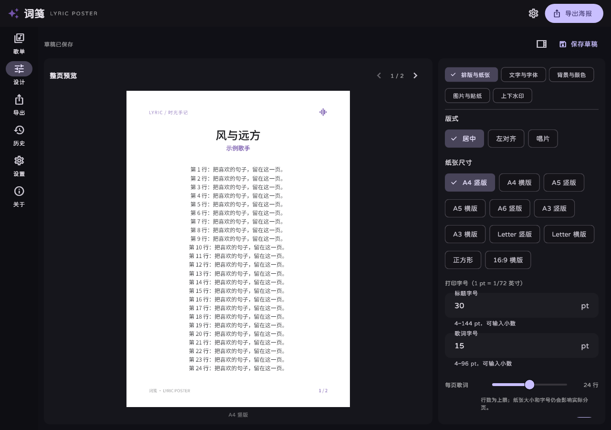

# 词笺 · Lyric Poster

把喜欢的歌，留在纸上。支持 Windows 和 Android 的免费开源歌词海报工具。

[下载最新版](https://github.com/yipianxiaoye/lyric-poster/releases/latest) · [项目主页](https://yipianxiaoye.github.io/lyric-poster/) · [反馈问题](https://github.com/yipianxiaoye/lyric-poster/issues)

## 下载

前往 [下载页面](https://github.com/yipianxiaoye/lyric-poster/releases/latest)，选择适合你的文件：

- **Windows 10/11 x64**：下载 `setup.exe` 安装，也可下载 ZIP 使用便携版。
- **Android**：下载 APK 安装；首次更新时按提示允许词笺安装应用，再确认系统安装界面。

## 主要功能

- 导入网易云公开歌单、搜索歌曲，也可手动输入和修改歌词。
- 点击海报直接编辑，自定义标题、歌词字号和上下水印。
- 调整背景颜色，拖动缩放背景图，添加图片贴纸和自定义字体。
- 支持 A3、A4、A5、A6 等纸张，调整每页歌词行数，完整歌词自动分页。
- 导出高清 PNG 和多页 PDF，方便打印与保存。
- 外语歌词支持同时显示和导出网易云已有译文，逐句排版；译文字体和字号可独立设置，也可手动填写译文。
- 保存导入歌单与海报草稿，随时继续编辑。
- 启动时自动检查更新；关于页和更新提示会展示版本说明，可选择 GitHub 或镜像下载，也可打开发布页。

## 三步制作

1. **选歌**：粘贴歌单链接、搜索歌曲，或输入自己的文字。
2. **设计**：选择纸张，调整字号、颜色、背景和水印，实时查看效果。
3. **导出**：保存 PNG 或多页 PDF，再按所选纸张打印。

## 作者与开源

由 [yipianxiaoye](https://github.com/yipianxiaoye) 开发，原创代码采用 [MIT 许可证](LICENSE)。第三方字体和组件见 [第三方声明](THIRD_PARTY_NOTICES.md)。欢迎反馈和参与改进。

本项目与网易云音乐无隶属关系。歌词、封面等内容归相应权利人所有，打印和分享时请遵守相关版权与平台条款。
