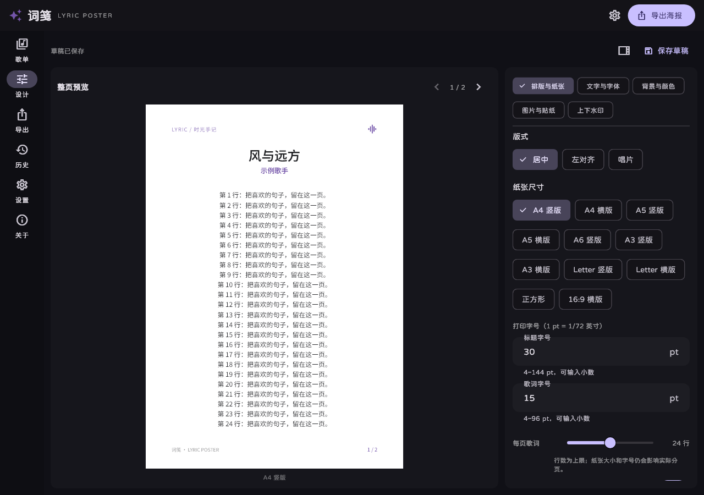

# 词笺 · Lyric Poster

把喜欢的歌，留在纸上。一个使用 Flutter 开发的开源歌词海报工具，支持 Windows 和 Android，适合整理、设计和打印完整歌词。

[项目主页](https://yipianxiaoye.github.io/lyric-poster/) · [下载最新版](https://github.com/yipianxiaoye/lyric-poster/releases/latest) · [反馈问题](https://github.com/yipianxiaoye/lyric-poster/issues) · [作者 GitHub](https://github.com/yipianxiaoye)



## 下载与使用

在 [Releases](https://github.com/yipianxiaoye/lyric-poster/releases/latest) 选择对应平台的文件：

- **Windows 10/11 x64**：下载 Windows ZIP，完整解压后运行 `lyric_poster.exe`。DLL 和 `data` 目录需要保留在 EXE 旁边。
- **Android**：下载 APK 并安装。系统提示时，为下载使用的浏览器或文件管理器允许安装此来源的应用。
- GitHub Pages 是软件介绍和下载页；编辑、保存与导出在应用内完成。

1.5.1 及更早的预览 APK 使用预览证书；从 1.5.2 本地正式构建起使用独立正式证书，无法直接覆盖旧预览版。迁移前请先导出或备份旧版资料，后续正式版本将复用同一把正式密钥；本地构建状态不代表该版本已公开发布。自行构建请使用自己的签名密钥，不能直接覆盖安装其他签名的版本。Windows 便携包未做代码签名，系统可能显示来源提示。

## 功能

- **导入和搜索**：粘贴网易云公开歌单链接、分享文本或数字 ID；搜索歌曲并读取名称、歌手、专辑封面和公开歌词，也可手动新建或校对歌词。
- **直接编辑**：点击海报中的标题、歌词或水印开始编辑；电脑使用常驻设计侧栏，手机将工具停靠在预览下方，调整时可查看版面。
- **固定打印版式**：标题、歌词字号支持数值输入（pt）；每页最多歌词行数可在 8–40 行之间调整，默认 24 行，再按纸张和实际字体自动换行、分页。
- **完整歌词分页**：完整导出多页歌词；歌名、歌手和专辑信息只在第一页显示。顶部、底部水印可独立修改内容或隐藏。
- **颜色和图片**：默认白色纸张；调色盘、20 个常用色和 HEX 输入；背景图可拖动、缩放，可加入图片贴纸。
- **自定义字体**：应用界面使用寒蝉全圆体原生常规字重；海报默认使用 Noto Sans SC，支持导入 TTF/OTF，重启后保留，缺字回退到内置中文字体。
- **纸张和导出**：A3、A4、A5、A6、Letter、正方形及 16:9 等纸张与画幅；支持 300 DPI PNG 和多页 PDF。预览和导出共用版面与字体。
- **历史和设置**：保存导入过的歌单和可继续编辑的海报草稿；离线打开已保存歌单；六种软件主题、常用默认设置，以及作者信息页。
- **界面动画**：页面、设计工具分组及歌词翻页使用短暂的淡入和位移动画；遵循系统“减少动画”设置，实时编辑和导出保持稳定。

草稿会保存歌词、排版、字体、背景图、贴纸与图片位置。“历史 → 海报草稿”可继续编辑；“历史 → 导入歌单”可打开或联网更新歌单。导入自定义字体只影响海报，应用界面使用内置的寒蝉全圆体。

## 本地开发

当前构建基线为 **Flutter 3.44.8 / Dart 3.12.2**；Dart 版本约束见 `pubspec.yaml`，依赖锁定在 `pubspec.lock`。将项目放在纯英文路径下，可减少 Windows 原生工具链的路径兼容问题。

```powershell
git clone https://github.com/yipianxiaoye/lyric-poster.git
cd lyric-poster
flutter pub get --enforce-lockfile
flutter analyze
flutter test --no-pub
flutter run -d windows
```

Android 开发还需要 Android SDK、兼容的 JDK 17，以及模拟器或手机；可使用 `flutter run -d <设备ID>`。仓库保留其他 Flutter 平台工程，目前发行文件面向 Windows 和 Android。

依赖锁文件使用 `https://pub.flutter-io.cn` 作为包服务地址；如需与其保持一致，可在当前 PowerShell 会话设置后拉取依赖：

```powershell
$env:PUB_HOSTED_URL = 'https://pub.flutter-io.cn'
flutter pub get --enforce-lockfile
```

### Windows 构建

需要 Visual Studio 2022 C++ Build Tools：MSVC x64/x86、CMake、Windows SDK。Flutter 插件需要符号链接支持，可通过 Windows 开发者模式启用。

`scripts/setup-windows.ps1` 使用微软官方安装器，默认将工具和缓存放到 D 盘。该脚本涉及管理员权限和微软许可；`-EnableDeveloperMode` 会修改开发者模式设置。阅读脚本并同意这些操作后，在管理员 PowerShell 中运行：

```powershell
powershell -NoProfile -ExecutionPolicy Bypass -File .\scripts\setup-windows.ps1 -AcceptLicense -EnableDeveloperMode
```

随后在普通 PowerShell 中打包：

```powershell
powershell -NoProfile -ExecutionPolicy Bypass -File .\scripts\build-windows.ps1
```

脚本会在独立英文目录构建，检查依赖、运行测试，并将完整便携目录和 ZIP 写入 `dist/`，日志写入 `work/windows/`。发行包包含应用资源、Visual C++ 运行库及许可证。`-CheckOnly` 只检查环境；`-StagingParent` 可修改暂存根目录，`-ExistingBuildDirectory` 可复用脚本创建的构建目录。

仅需 Flutter 原生构建时，也可运行：

```powershell
flutter build windows --release --no-pub
```

### Android 构建

首次正式构建时创建自己的签名，已有正式签名则跳过创建步骤并复用。详细步骤、备份恢复与预览版迁移说明见 [Android 正式签名教程](docs/android-signing.md)。

```powershell
powershell -NoProfile -ExecutionPolicy Bypass -File .\scripts\setup-android-signing.ps1
powershell -NoProfile -ExecutionPolicy Bypass -File .\scripts\build-android.ps1 -SigningProperties "$env:USERPROFILE\.lyric-poster\signing\release\key.properties"
```

签名向导支持交互输入密码或 `-GeneratePassword` 生成强密码，私钥和含密码的 `key.properties` 保存在仓库外的私有目录，不会修改已有预览签名。请加密备份整个签名目录，后续升级必须使用同一密钥。打包脚本默认运行测试并验证 APK 签名、版本与架构，将通用 APK 和校验文件写入 `dist/`。正式构建时始终显式指定 `-SigningProperties`，避免使用为历史兼容保留的默认预览配置。

GitHub Actions 会执行静态分析和测试，并分别构建 Windows ZIP 与 Android APK 供检查。CI 使用各次环境自行生成的测试签名，仅供验证，不能覆盖安装公开发行的 Android 版本。原生 Flutter 测试构建仍需显式设置 `LYRIC_POSTER_ALLOW_DEBUG_SIGNING=true` 才会允许临时测试签名。

### 联网检查

单独检查公开歌单及第一首歌的歌词（需要联网，不属于默认测试）：

```powershell
dart run scripts/check_playlist.dart <歌单ID>
```

## 参与贡献

欢迎通过 [Issues](https://github.com/yipianxiaoye/lyric-poster/issues) 提交复现步骤或功能建议，也欢迎 Pull Request。提交前请执行 `flutter analyze` 和 `flutter test`，涉及界面或导出时请附上不含个人信息的截图或示例。

不要提交账号 Cookie、签名密钥、密码、真实用户草稿或其他私密资料。`build/`、`dist/`、`work/` 和签名配置已加入忽略规则。

## 许可证与内容

原创代码采用 [MIT License](LICENSE)，作者为 [yipianxiaoye](https://github.com/yipianxiaoye)。第三方组件及字体的许可见 [THIRD_PARTY_NOTICES.md](THIRD_PARTY_NOTICES.md)；内置寒蝉全圆体与 Noto Sans SC 均使用 SIL Open Font License 1.1，原始许可分别见 [ChillRoundF-OFL.txt](assets/fonts/ChillRoundF-OFL.txt) 和 [OFL.txt](assets/fonts/OFL.txt)。

应用请求网易云公开元数据和歌词，不要求账号登录，不提供音频下载或 DRM 绕过功能；它是独立项目，与网易云音乐无隶属关系。外部接口可能变化，仍可手动输入和编辑歌词。本仓库的 MIT 许可不授予歌词、封面、第三方字体或商标的使用权，导入、打印及分享内容时请遵守相应版权和平台条款。
